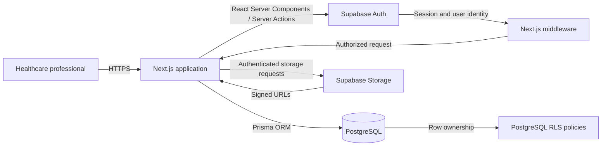

# Clinical Records Management

A secure, multi-user clinical management platform for maintaining patient records, clinical histories, sessions, appointments, and genogram files.

## Tech Stack


## Overview

Clinical Records Management gives healthcare professionals a focused workspace to organize patient information and preserve a structured clinical history.

### Key Features

- Multi-user authentication with protected patient routes.
- Patient creation, editing, archiving, and filtering.
- Clinical history, personal and family antecedents, and vital history.
- Session notes and appointment scheduling.
- Genogram image upload, replacement, signed preview URLs, and deletion.
- Rich-text clinical content editing.
- Server-side authorization that always associates records with the authenticated user.
- PostgreSQL Row Level Security policies for direct database access protection.
- Responsive interface built with reusable, accessible UI components.

## System Architecture



## Engineering Highlights

- **Server-first security:** server actions validate every authenticated user's session and patient ownership.
- **Defense in depth:** application-level checks are paired with Supabase Auth and PostgreSQL RLS policies.
- **Relational data modeling:** Prisma models patients, anamnesis, sessions, and appointments with cascading deletes and indexed ownership fields.
- **Privacy-oriented access:** patient and session operations are scoped through `userId` relationships.
- **Storage isolation:** genogram files are stored per patient and delivered through short-lived signed URLs.
- **Type-safe validation:** Zod schemas validate form and server action inputs.
- **Modern Next.js:** React Server Components, server actions, middleware, and responsive client components.

## Getting Started

### Prerequisites

- Node.js 20 or later
- npm
- A Supabase project
- A PostgreSQL connection

### Installation

1. Clone the repository:

   ```bash
   git clone https://github.com/ElAgus1/clinical-records-management.git
   cd clinical-records-management
   ```

2. Install dependencies:

   ```bash
   npm install
   ```

3. Create your local environment file:

   ```bash
   cp .env.example .env.local
   ```

   Complete [`DATABASE_URL`](https://supabase.com/dashboard) with the Supabase transaction pooler connection string and [`DIRECT_URL`](https://supabase.com/dashboard) with the direct connection string. Add the project URL and anon key from the Supabase API settings.

4. Generate the Prisma client and sync the database schema:

   ```bash
   npm run db:generate
   npm run db:push
   ```

5. Configure Supabase:

   - Create a professional user in **Supabase Dashboard > Authentication > Users**.
   - Run [`supabase/rls.sql`](./supabase/rls.sql) in the Supabase SQL Editor after the schema has been pushed.
   - Create a Supabase Storage bucket named `genogramas` and grant the appropriate authenticated access policies.

6. Start the development server:

   ```bash
   npm run dev
   ```

The application is available at [http://localhost:3000](http://localhost:3000).

## Useful Commands

```bash
npm run dev         # Start the development server
npm run build       # Create a production build
npm run start       # Start the production server
npm run lint        # Run ESLint
npm run db:generate # Generate the Prisma client
npm run db:push     # Sync the Prisma schema
npm run db:migrate  # Create and apply development migrations
npm run db:studio   # Open Prisma Studio
```

## Screenshots and Demo

Add portfolio screenshots and a hosted demo link when available.


- **Live demo:** https://your-deployment-url.example
- **Documentation:** https://your-documentation-url.example
